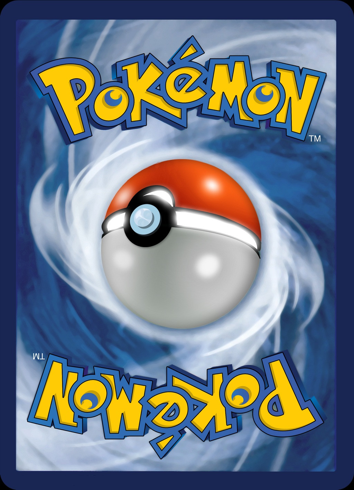

# Pokédex AR

Aplicación de realidad aumentada desarrollada para la tercera evaluación de la
asignatura **Realidad Virtual y Aumentada**. La aplicación permite visualizar
contenido de Pokémon en un entorno real utilizando un dispositivo Android.

## Información académica

- **Asignatura:** Realidad Virtual y Aumentada
- **Evaluación:** Tercera evaluación
- **Código:** D-ELEC-II-IEI-RVIRTUAL-OP1
- **Profesor:** Sebastián Alvarez Trujillo
- **Estudiante:** [Miguel Burgos](https://github.com/Koki-html)

## Imágenes objetivo

Las imágenes necesarias para activar la experiencia se encuentran en la carpeta
[`Assets/Targets`](Assets/Targets).

## Modelo de terceros

El modelo de Gengar fue creado por [Code_6122](https://sketchfab.com/3d-models/gengar-pokemon-b24c17c4cdb74b15a15fab7363c2b5bb)
y se utiliza bajo la licencia
[CC BY 4.0](https://creativecommons.org/licenses/by/4.0/).

El modelo de Pikachu fue creado por [jacobjksn42](https://sketchfab.com/3d-models/pikachu-c22dab8fc3064c76a0c502d64555a74f) 
y se utiliza bajo la licencia
[CC BY 4.0](https://creativecommons.org/licenses/by/4.0/).
## Créditos

Proyecto realizado por **Miguel Burgos** para la asignatura **Realidad Virtual
y Aumentada**. 

## Declaración de Uso de Inteligencia Artificial Generativa.

Parte del Readme.MD fue generado a base del uso de Inteligencia Artificial, y posteriormente modificado por el estudiante a su necesidad y deseo. 

Profe pongame un 7 lo tkm.
